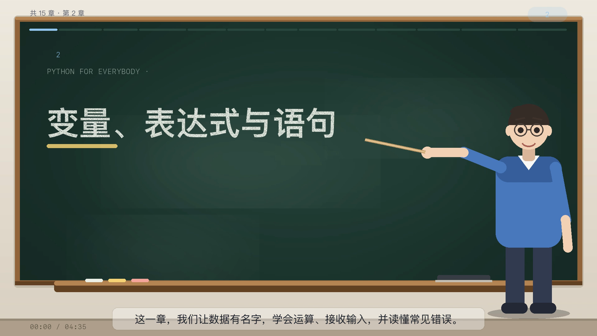

# Teacher + Blackboard Video Course

用 Python 和 PIL 制作中文教学视频的可复现工具包：老师站在黑板前讲解，旁白、字幕、板书、代码终端、练习题和章节回顾由同一份内容数据生成。

这套工程来自一套 15 章的 Python 入门视频，但脚本和制作规则可以复用到其他技术课程。



## 这套工程解决什么

- 用一份 `(旁白, 板书)` 数据同时驱动 TTS、字幕、黑板和老师教鞭。
- 章节首屏保持“章节号 + 标题 + 老师”到开场旁白结束，字幕从第一句开始。
- 代码保留缩进，超长行自动缩小字号，不越出黑板。
- 练习题单独成页，板书展示题目、流程、左右代码面板和验收标准。
- 片尾回顾显示本章具体概念、验证边界、练习名和下一章。
- 时间轴 JSON、SRT 与 MP4 同一次生成，便于后续剪辑和上传。
- 提供字幕与布局检查脚本，先拦截原始代码管道符、过长视频和缺失文件。

## 快速开始

### 依赖

- Python 3.11+
- Pillow
- edge-tts
- ffmpeg 与 ffprobe
- macOS 字体：PingFang 和 SF Mono

安装 Python 依赖：

```bash
python3 -m venv .venv
source .venv/bin/activate
pip install -r requirements.txt
```

### 配置路径

`scripts/build_ch02.py` 默认读取同目录的 `content/`。如果你的目录结构不同，修改脚本顶部的 `ROOT`：

```python
ROOT = "/path/to/teacher-blackboard-video-course"
```

### 生成一章

```bash
python scripts/build_ch02.py --chapter 12 --reuse-audio
```

第一次生成会调用 edge-tts 合成缺失音频。修改旁白后，如需重新配音，请更换缓存名或删除对应的 `work/mp3_chXX/` 缓存。

只生成用于审阅的静帧：

```bash
python scripts/build_ch02.py --chapter 12 --preview
```

输出：

```text
outputs/python-ch12.mp4
outputs/python-ch12.srt
outputs/python-ch12-timeline.json
outputs/python-ch12-poster.png
outputs/narration-ch12.txt
```

## 内容格式

每一章由 `content/remaining_chapters.py` 中的 `CHAPTERS` 提供。`content/chapter2_content.py` 是第 2 章的独立内容文件。

核心结构：

```python
_scene(
    "03 / urllib 与网页",
    "用库处理网络细节",
    "code",
    [
        ("Python 的 urllib 可以发起网页请求、读取响应内容。", "urllib.request 获取网页"),
        ("读取后按正确编码解析。", "文字编码 · 二进制内容"),
        ("|from urllib.request import urlopen|data = response.read()", "读取响应"),
        ("下载前要遵守网站规则。", "访问频率 · 使用规则"),
    ],
)
```

每个 beat 的第一个值是旁白，第二个值是板书。以 `|` 开头的板书是代码，`|` 只负责分隔黑板行，不应进入旁白或 SRT。

## 制作规范

### 画面

- 首屏必须是带章节号、章节名和老师的封面黑板。
- 标题画面至少持续到开场旁白结束，再进入正文。
- 字幕从开场旁白开始，不能空白。
- 老师人物位于右侧，教鞭指向当前讲解区域。
- 正文保留概念、关系和例子；黑板上不能只有标题。

### 旁白与字幕

- 旁白先解释概念，再说明例子和结果。
- 字幕读的是解释，不是代码标点。
- 中英文和数字之间保留空格。
- CPU 主频写作 `3.0 GHz` 或“三点零吉赫兹”，不能写“三点零吉”。
- 中文句末问号直接跟在句子后；不要为了换行另起一个 `?`。
- 代码块的 `|` 不能出现在 SRT。

### 练习题

练习页必须包含：

1. 题目。
2. 解决流程。
3. 左右两个代码面板。
4. 可执行的验收标准。

练习标题要与片尾回顾一致，并出现在板书上。

### 片尾

片尾不要只写“把概念变成程序”或“本章关键概念”。应列出：

- 本章具体概念和关系。
- 验证边界。
- 本章练习名。
- 下一章主题。

### 时长

入门章节建议 3–5 分钟。每章至少包含：

- 1 个封面。
- 4 个核心知识场景。
- 5–6 个扩展场景。
- 1 个完整练习页。
- 1 个具体回顾页。

若成片只有 1 分多钟，检查扩展场景是否被 `EXTENDED_SCENES` 合并、音频是否错误复用，以及 `SCENES` 是否缺少场景。

## 检查

运行仓库检查：

```bash
python scripts/check_outputs.py --output-dir outputs --min-seconds 180
```

检查内容包括：

- MP4、SRT、timeline 是否齐全。
- 每章时长是否达到下限。
- SRT 是否出现 `|`、连续问号或异常换行。
- timeline 的 `show` 与 `say` 是否都有效。
- 每章是否包含练习页和回顾页。

## 可复用 Codex skill

[skills/teacher-blackboard-video/SKILL.md](skills/teacher-blackboard-video/SKILL.md) 记录了下一套视频的完整工作流和验收清单。把 `skills/` 下的目录安装到 Codex 技能目录后，可以让下一个视频任务直接复用这些规则。

## 目录

```text
scripts/        视频生成器与输出检查器
content/        第 2–15 章内容与共享章节数据
skills/         可复用 Codex skill
workflow/       制作流程、审查清单、问题记录
metadata/       YouTube 播放列表、标题和简介
assets/         封面、练习页、片尾示例
checks/         本仓库输出检查结果
```

## 经验

详见 [workflow/lessons-learned.md](workflow/lessons-learned.md)。最重要的几条：

- 一份数据驱动所有输出，避免旁白和板书各写一套。
- 先做预览页，再渲染整章；一页布局错误会放大成数千帧。
- 音频缓存要和文案版本绑定，否则旧旁白会被复用。
- 把代码和解释分开存，避免 TTS 读管道符。
- 每章都要有可检查的练习和具体回顾，不能只靠通用片尾。
- 成片验收看字幕、静帧、时长，不只确认“命令成功”。

## 许可证

代码使用 MIT License。课程文案、品牌和视频素材的使用权由项目所有者负责确认。

## 视频归档

仓库只保存可复用的生成代码和文档。15 章成片、SRT 和 timeline 保留在本地交付目录：

`python-chapters-01-15/`

大文件建议发布到 GitHub Release 或对象存储，不要直接提交到普通 Git 历史。
